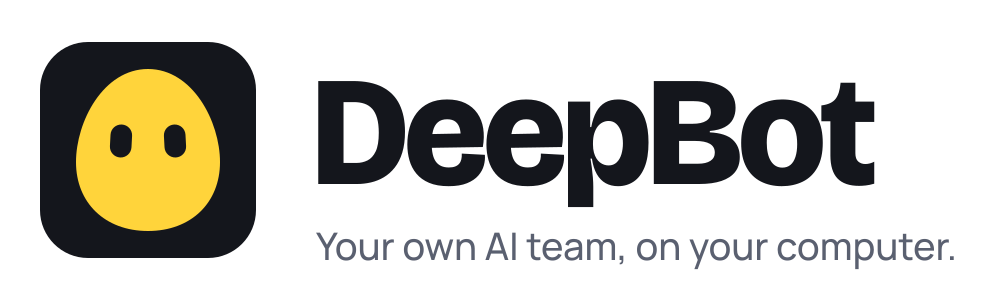

  <picture>
    <source media="(prefers-color-scheme: dark)" srcset="banner-dark.svg">
    
  </picture>

  <a href="https://github.com/miljushm/deepbot-releases/releases/latest"><b>Download for Windows</b></a>
  &nbsp;·&nbsp;
  <a href="https://deepbot.studio">deepbot.studio</a>

---

DeepBot gives you Bots that do the work, not just talk about it. Each one has its own browser,
terminal and files, and they hand work to each other.

- **It does the work.** Bots open pages, fill in forms, run commands and save files. You can watch
  every step, or come back when they say it is done.
- **Ask for the thing, get the thing.** Websites, 3D explanations, promos, small games and
  printable 3D parts, right in the chat.
- **It remembers and gets faster.** A memory for each Bot, and jobs that went well become skills
  and recipes it reuses.
- **On a schedule.** Routines run while your computer is on; talk to your Bots from your phone.
- **You approve before anything live changes.** Before a Bot touches DNS, a server, accounts or
  payments, it shows the plan and waits for your Approve.
- **Your model, your rules.** Use a provider with your own key, or a model that runs on this
  computer and never leaves it.

## Installing

- Windows 10 or 11, 64-bit. Installs for one user, without administrator rights.
- The first start asks how you want to think: your own provider key, or a model that runs here.
- Windows may show a SmartScreen warning, because the installer is not signed with a bought
  certificate yet. Choose **More info**, then **Run anyway**.

## Your data

Your chats, your Bots' files, their memory and your keys stay on your computer, in
`%LOCALAPPDATA%\DeepBot\data`. An update never touches that folder.

## Terms

By downloading, installing or using DeepBot you accept the
[Terms of service](https://deepbot.studio/terms), and you agree to the
[Privacy policy](https://deepbot.studio/privacy).

## About this repository

This repository holds releases only: the installer, its signature, `latest.json` (what an installed
DeepBot reads to find a new version) and the checksums. The code lives elsewhere, and a commit is
not a release.

The list of releases is the changelog - each one is written for the person using DeepBot.
